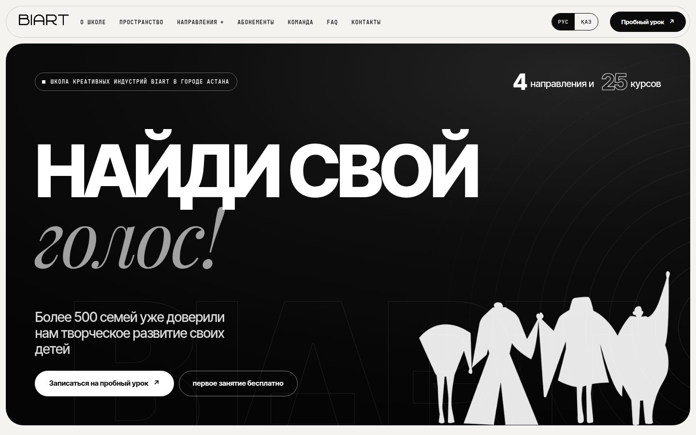
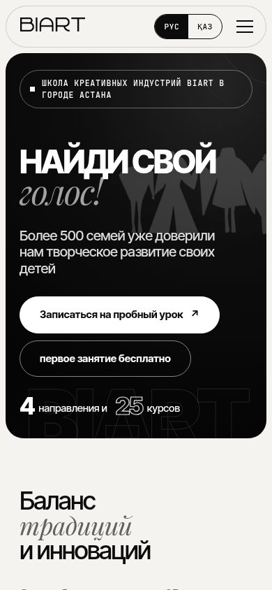
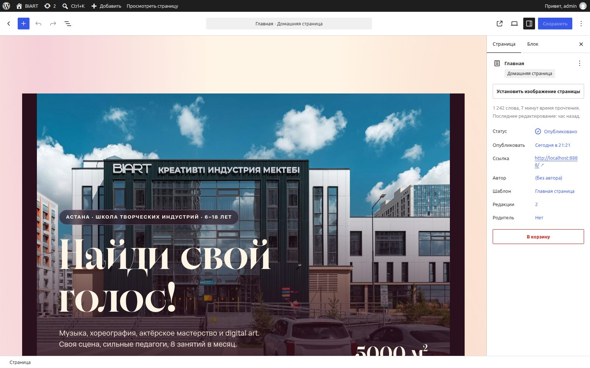

# BIART Mono — чёрно-белая версия сайта (эксперимент)

Отдельная копия проекта BIART для сравнения дизайна. **Основной проект (`../BIART`) не изменён**, демо `kavdas.github.io/biart-demo` не затрагивается (`npm run deploy` здесь отключён).

- **Дизайн («high fashion»):** чёрно-белый, без цветных пятен. Плавающая шапка-«пилюля», скруглённые тёмные карточки с зерном, гигантская типографика Inter Tight с курсивным серым акцентом (Playfair Display Italic, `<em>` в заголовке), моно-подписи (JetBrains Mono) и нумерация `[01]`, рамка с «+» на пересечениях линий, бегущая курсивная строка, кольца звука и белые силуэты персонажей в первом экране, слово-логотип BIART во всю ширину в подвале.
- **Что взято с референсов:** Stodio — пилюли-теги, `[01]`, огромный список «услуг» с превью фото при наведении, лента высоких скруглённых фото, скруглённые тёмные блоки; Addco — крупные двухтоновые заголовки, призрачное слово-фон, рамки с «+», крупные цитаты отзывов.
- **Фото:** статичные декоративные фото убраны (фасад, залы, направления). «Пространство» и «Направления» — списки, фото появляются у курсора по наведению (на телефоне раскрываются тапом; `assets/js/hover-preview.js`). Остались только фото из ТЗ: команда, саунд-драма и квиз в «О школе», лента афиши. Все фото чёрно-белые.
- **Контент:** главная перестроена по ТЗ (`ТЗ на сайт 1.docx`): новый первый экран, кнопки-ссылки на разделы, «Баланс традиций и инноваций», «4 направления и 25 курсов», «О школе» с фото саунд-драмы и квиза и 4 цифрами, «Наши преимущества», команда с кнопкой «Записаться на пробное занятие», «Прозрачные цены на абонементы», «Отзывы наших родителей», блок «Возникли вопросы?», «Оставить заявку». Всё из основного проекта сохранено (две языковые версии, расписание, оферты, карусель, окно биографий, лайтбокс, SEO, безопасность).
- **Запуск:** `npm run start` → http://localhost:8890 (admin / password), затем `npm run setup` и `npm run seed`. Порты 8890/8891 не пересекаются с основным проектом. `node_modules` — ссылка на `../BIART/node_modules`.
- Статичный слепок: `python3 tools/export-static.py`, смотреть — `python3 -m http.server 8899 --directory dist`.
- Открытые вопросы по ТЗ: процент удовлетворённости оставлен как «ХХ%»; форма «Возникли вопросы?» — кнопка «Далее» ведёт в WhatsApp (нативные блоки без Custom HTML не дают формы); казахские тексты новых блоков — черновой перевод, нужна проверка носителем.

---

# BIART — сайт школы креативных индустрий (Астана)

Лендинг на **WordPress** для школы BIART: блочная тема, собранная кодом по брендбуку.
Главное требование — сайт **редактируется клиентом через админку** нативными блоками, а не «мёртвая картинка».

**Живое демо:** https://kavdas.github.io/biart-demo/ — русская версия, https://kavdas.github.io/biart-demo/kz/ — казахская (статичный слепок WordPress-версии; обновление — `npm run deploy`).

| Десктоп | Мобильная версия | Редактор WordPress |
|---|---|---|
|  |  |  |

## Что сделано

- **Две языковые версии**: русская `/` и казахская `/kz/` (переключатель РУС / ҚАЗ в шапке, свои шапка и подвал, `lang="kk"`). Казахский текст — `theme/content/home-kz.html`, собирается из русского скриптом `tools/build-kz.py`.
- **11 секций главной**: hero, преимущества, о школе + цифры, каталог всех направлений (4 области, 25 курсов), цены (абонемент 30 000 ₸ / индивидуально 80 000 ₸ / пробный 0 ₸), наша команда (директор и кураторы), пространство (карусель на 39 фото со счётчиком), афиша, отзывы с рейтингом 2ГИС, FAQ, контакты с WhatsApp.
- **Юридические страницы** перенесены со старого сайта: [договор публичной оферты](theme/content/oferta.html), [оферта подарочного сертификата](theme/content/oferta-sertifikat.html), [политика конфиденциальности](theme/content/privacy.html) — нативными блоками, ссылки в подвале.
- **Фирменный стиль по брендбуку**: палитра (бордо `#692445`, вермилион `#db4d37`, розовый `#e8a3c7`, кремовый `#fff5e6`), оригинальные шрифты **CoFo Raffine** и **Adapter PE** (self-hosted woff2), иллюстрации и леттеринг MUSIC / DANCE / ACTING / DIGITAL, росчерк-submark как декор секций, брендовые градиентные фоны.
- **Контент — по документам школы** (инструкция отдела продаж): возраст 6–18, формат 8 занятий/мес по 50 минут, часы работы, правила пробных и пропусков.
- **Редактируемость**: контент лежит в странице «Главная», секции залочены `templateLock: contentOnly` — клиент правит тексты и фото, но не ломает вёрстку. Роль «Редактор» с урезанным меню админки.
- **Только нативные блоки Gutenberg** (`group / columns / heading / paragraph / image / buttons / details`) — никакого Custom HTML, стили темы одинаково работают на фронте и в редакторе.
- Адаптив (781px — брейкпоинт WordPress), sticky-шапка, мобильное меню-бургер, плавающая кнопка WhatsApp на телефоне, кнопки записи ведут в WhatsApp с предзаполненным сообщением.
- **Безопасность в теме** (`theme/inc/security.php`): XML-RPC выключен, перечисление пользователей закрыто, отпечатки WP убраны, комментарии отключены, заголовки CSP / X-Frame-Options / Referrer-Policy / Permissions-Policy. Карта в контактах — нативный блок «Embed» со ссылкой на виджет Яндекс Карт (`theme/inc/embeds.php` превращает её в iframe; CSP разрешает фреймы только с yandex.ru/kz/com). Чек-лист для хостинга — [docs/SECURITY.md](docs/SECURITY.md).
- **SEO** (`theme/inc/seo.php`): description RU/KZ, hreflang, Open Graph + картинка превью, favicon, JSON-LD организации. Фирменная страница 404.

## Документация

- [docs/ADMIN.md](docs/ADMIN.md) — инструкция для школы: что и как править в админке, чего делать нельзя, что делать, если сломалось.
- [docs/DEPLOY.md](docs/DEPLOY.md) — замена нынешнего сайта на biart.kz: бэкап, перенос, HTTPS, карта 301-редиректов со старых `/ru/` и `/kk/` адресов, проверка, откат.
- [docs/SECURITY.md](docs/SECURITY.md) — чек-лист по безопасности хостинга.
- [CLAUDE.md](CLAUDE.md) — правила сборки темы.

## Стек

- WordPress 7.1 / PHP 8.2, блочная тема `theme/` (`theme.json`, `style.css`, `functions.php`, шаблоны `templates/`, части `parts/`)
- Локальная среда: `@wordpress/env` (Docker)
- Инструменты в `tools/`: заливка контента, полностраничные скриншоты (Playwright), статичный экспорт для демо

## Запуск локально

```bash
npm install
npm run start     # http://localhost:8888  (admin / password)
npm run setup     # один раз: язык, тема, настройки
npm run seed      # залить контент RU (theme/content/home.html) и KZ (home-kz.html)
```

Статичный слепок для демо без WordPress: `python tools/export-static.py` → `dist/`.

Новое фото шириной от 760 px в `theme/assets/img/` — прогнать `python3 tools/make-responsive.py`: он сделает копии `-480w`/`-800w`, и тема сама подставит их в `srcset`. `style.css` правится как обычно — сжатую копию в `uploads/biart/` тема пересобирает сама.

## Структура

```
theme/
  style.css          токены бренда (:root + мобильные), @font-face, стили секций
  theme.json         палитра, шрифты, layout
  functions.php      подключение стилей на фронт и в редактор, блокировки для клиента
  templates/         front-page / page / index
  parts/             header / footer (RU и KZ)
  inc/               security.php, seo.php
  content/home.html  контент главной (нативные блоки)
  assets/            шрифты, логотипы, иллюстрации, фото (оптимизированные)
tools/               скрипты сборки и проверки
docs/                превью
CLAUDE.md            правила сборки темы
```

## Что ждём от школы для финала

Фотографии директора, кураторов и педагогов (сейчас плейсхолдеры), казахские версии юридических страниц, SVG-логотип, веб-лицензия на шрифты CoFo.
